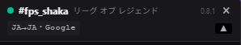
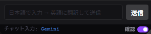

# Twitch Chat Translator

[日本語](README.md) | [English](README.en.md) | [Русский](README.ru.md)


📖 **For detailed usage, FAQ, and troubleshooting, see the [Wiki](https://github.com/KAWAchan-jp/twitch-chat-translate-ext/wiki)** (English overview available)

**A Chrome extension that removes the language barrier from Twitch**

> *“Sans Babel”* means “without Babel” in French.
> According to the Book of Genesis, the Tower of Babel caused people’s languages to be confused and created language barriers.
> This extension was built to remove those barriers.

| | |
|---|---|
| 💬 **Translate chat in real time** | Instantly translate fast-moving chat into Japanese and enjoy foreign-language streams together with the chat |
| ✏️ **Join chat in Japanese** | Type in Japanese and send automatically translated messages, even when the streamer uses another language |
| 🤖 **Gemini AI translation** | Use Gemini AI for sent-message translation. It produces natural translations for game terms and slang |

---

## Features

### Chat Translation

- **Real-time translation** — Automatically translates messages as they arrive using Google Translate or DeepL, with three-way parallel processing.
- **High-speed chat mode** — When chat is moving quickly (3 messages/sec or more), translation is automatically reduced and original messages are shown. Pause scrolling or hover to translate only the visible range and save API usage.
- **Translation engine display** — The header always shows the translation direction and engine, such as `JA→JA・Google`. It turns orange when channel-specific settings are active.
- **Footer translation engine indicator** — The bottom of the panel shows your message translation engine in real time. Click to cycle through enabled engines.
- **Automatic stream language detection** — Reads Twitch tags and automatically sets the source language.
- **Floating panel** — Stays in the lower-right corner of the page. Drag the header to move it, drag the lower-right handle to resize it, and adjust opacity.
- **Automatic channel detection** — Detects the channel from the URL and supports Twitch SPA navigation.
- **Per-channel language settings** — Remembers source and target languages per channel and switches automatically.
- **Scroll pause** — Scrolling upward pauses auto-scroll and shows a “↓ Latest” button.
- **Translation cache** — Reuses cached results for identical text to save DeepL character usage.
- **Translate and send** — After logging in to Twitch, send translated messages from the panel input field.
- **Minimum length filter** — Skips short taunts or emote-like strings. The character count can be adjusted.
- **Same-language filter** — Skips messages already written in the target language.

### Gemini AI Translation

- **Model selection** — Choose from Gemini 2.5 Flash (recommended), 3.1 Flash Lite, 3 Flash, and 3.5 Flash.
- **Per-feature selection** — Turn Gemini on/off for sent messages. Chat translation remains Google / DeepL because chat volume is high and Google is recommended.
- **Prompt editing** — Freely customize the translation prompt from the options page. `{lang}` is replaced with the target language and `{text}` with the text to translate.
- **Fallback** — If Gemini is disabled or fails, the extension automatically falls back in order: DeepL → Google Translate.
- **Free tier** — 1,500 requests/day and 15 requests/minute. Get an API key from Google AI Studio.

---

## Requirements

- **Chrome** latest version with Manifest V3 support.

---

## Installation

1. Download this repository as a ZIP file, or run `git clone`.
2. Open `chrome://extensions/` in Chrome.
3. Turn on **Developer mode** in the upper-right corner.
4. Click **Load unpacked** and select the `extension/` folder.
5. Click the puzzle icon (🧩) in the toolbar and pin **Twitch Chat Translator**.

---

## Usage

### Panel Header



| Display | Description |
|---------|-------------|
| ● Status dot | Chat connection status: green = connected, blinking yellow = connecting, pink = disconnected/stopped |
| **#channel name** | Connected channel. The game being played is also shown on the right |
| **EN→JA・Google** | Translation direction and engine. **Orange** means channel-specific language settings are saved |
| Number such as 0.6.37 | Extension version |
| **×** | Closes the panel and stops chat receiving/translation |

### Panel Footer



The panel footer shows the currently used translation engines in real time.

| Display | Description |
|---------|-------------|
| **Chat input:** | Translation engine for messages you type and send (Google / <span style="color:#00c4a0">DeepL</span> / <span style="color:#4285f4">Gemini</span>) |

Changes made on the options page are reflected in the footer in real time. **Clicking the footer item cycles through the engines you've enabled** (Google→DeepL→Gemini — engines not enabled in options are skipped).

| Action | Behavior |
|--------|----------|
| Click the icon | Toggle the panel on/off (hidden by default) |
| Right-click the icon | Change source/target languages and display settings |
| Drag the panel header | Move the panel |
| Drag the lower-right handle | Resize the panel |
| Scroll upward in the panel | Pause auto-scroll |
| “↓ Latest” button | Move to the bottom and resume auto-scroll |

Language settings are saved per channel. They switch automatically when you move to another channel.

### Switching Translation Engines

Click any item in the footer to cycle through the engines you've enabled in options — no need to open the settings page.

| Footer item | Engines cycled on click |
|---|---|
| **Chat input:** | Google → DeepL → Gemini (enabled ones only) |

> An engine must have its API key set and be enabled on the options page to appear in the cycle. Disabled engines are skipped.

### Sending Chat

1. Right-click the icon and set the source language.
2. Click **Log in with Twitch** in the panel.
3. After logging in, type in Japanese in the input field at the bottom of the panel and send.
4. The message is translated automatically and posted to the channel.

---

## Options

Open options by right-clicking the extension icon and choosing **Options**.

| Setting | Description |
|---------|-------------|
| **Enable DeepL** | Use DeepL instead of Google Translate |
| **DeepL feature selection** | Toggle DeepL separately for chat translation and sent messages |
| **DeepL API key** | Supports both free keys ending in `:fx` and paid keys |
| **Enable Gemini** | Enables Gemini AI. The per-feature toggle controls sent-message translation |
| **Gemini model** | 2.5 Flash (recommended) / 3.1 Flash Lite / 3 Flash / 3.5 Flash |
| **Gemini API key** | Get one from Google AI Studio. Free tier: 1,500 requests/day and 15 requests/minute |
| **Gemini prompt** | Customize translation instructions. `{lang}` = target language, `{text}` = text to translate |
| **Default target language** | Target language used when no channel-specific setting exists |
| **Same-language filter** | Skip messages already in the target language |
| **Minimum length filter** | Skip messages shorter than the specified character count |
| **Panel opacity** | Panel background opacity: 30-100%, default 80%. The panel becomes opaque on hover |

> The DeepL free tier allows 500,000 characters per month. The Gemini free tier allows 1,500 requests/day and 15 requests/minute. Use per-feature toggles to enable them only where needed.

---

## File Structure

```text
twitch-chat-translate-ext/
├── extension/              # Extension package loaded by Chrome
│   ├── manifest.json       # Extension settings (Manifest V3)
│   ├── background.js       # Service Worker (translation API proxy, cache, OAuth)
│   ├── content.js          # Content script main (constants, state, initialization, settings)
│   ├── content-panel.js    # Content script (Shadow DOM panel and UI)
│   ├── content-chat.js     # Content script (IRC, chat translation, high-speed chat)
│   ├── auth-callback.js    # Content script for OAuth callback
│   ├── help.html           # Usage page (right-click icon → “📖 Help”)
│   ├── options.html / options.js / options.css
│   └── icons/
├── scripts/
│   └── build-release.ps1   # Release ZIP packaging script
└── docs/images/            # Documentation images
```

---

## Technical Details

### Translation

Direct `fetch` requests to `translate.googleapis.com` are blocked by CORS, so requests are routed from `content.js` through `background.js` (Service Worker).

Translation engine priority: **Gemini → DeepL → Google**. Higher-priority engines are used when enabled, and the extension automatically falls back on errors.
Chat translation supports Google / DeepL only because chat volume is high and Gemini is not recommended for it. Sent messages can also use Gemini.
Results for identical text and language pairs are stored in an in-memory LRU cache to skip repeated translations.

### Chat Receiving and Sending

The extension connects directly to Twitch IRC over WebSocket: `wss://irc-ws.chat.twitch.tv:443`.

- Not logged in: read-only connection as an anonymous `justinfan` user.
- Logged in: authenticates with an OAuth token and sends messages using the `PRIVMSG` command.

### OAuth

Twitch Implicit Grant flow is used.

1. The extension opens `id.twitch.tv/oauth2/authorize` in a new tab.
2. After authentication, Twitch redirects to `kawachan-jp.github.io/twitch-chat-translate/`.
3. `auth-callback.js`, injected into that page, reads the token from the URL fragment and forwards it to `background.js`.

### Panel

The panel uses Shadow DOM to isolate it from page CSS: `attachShadow({ mode: 'open' })`.

---

## Default Settings

| Setting | Default |
|---------|---------|
| Source language | Auto detect |
| Target language | Japanese |
| Show original text | ON |
| Auto-scroll | ON |
| Use DeepL | OFF |
| Use Gemini | OFF |
| Gemini model | 2.5 Flash |
| Same-language filter | OFF |
| Minimum length filter | OFF (4 characters) |
| Panel opacity | 80% |

---

## Creating a Release ZIP

Create the distribution ZIP with the packaging script instead of manually zipping the whole repository.

```powershell
# Extension (twitch-chat-translator-vX.Y.Z.zip)
powershell -NoProfile -ExecutionPolicy Bypass -File scripts\build-release.ps1
```

The script uses the version from `extension/manifest.json` and generates `twitch-chat-translator-vX.Y.Z.zip`. In the ZIP, `manifest.json` is placed at the archive root. Development files such as `.github/`, `.gitignore`, and `CLAUDE.md` are not included in the release ZIP.

---

## Feature Requests and Improvements

Issues and pull requests are welcome. Feel free to suggest features that would make the extension more useful.

---

## License

[MIT License](LICENSE)
