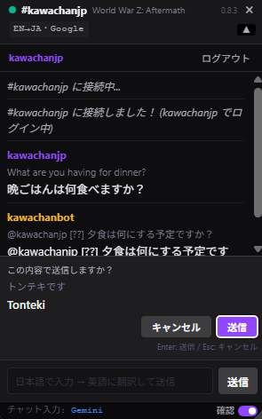
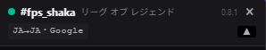
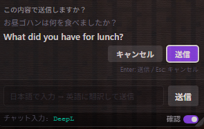

# Twitch Chat Translator

[日本語](README.md) | [English](README.en.md) | [Русский](README.ru.md)


📖 **詳しい使い方・FAQ・トラブルシューティングは [Wiki](https://github.com/KAWAchan-jp/twitch-chat-translate-ext/wiki) へ**（English overview available）

**Twitch の言葉の壁をなくす Chrome 拡張**

> *「サン・バベル」*（Sans Babel）— フランス語で「バベルなし」を意味します。
> 聖書の創世記によれば、バベルの塔が建てられたことにより神が人々の言語を混乱させ、言葉の壁が生まれたとされています。
> この拡張機能はその壁を取り除くために作られました。

| | |
|---|---|
| 💬 **チャットをリアルタイム翻訳** | 流れるチャットを即座に日本語へ。外国語配信もチャットごと楽しめる |
| ✏️ **日本語でチャットに参加** | 日本語で入力すると自動翻訳して送信。言語が違っても配信者と話せる |
| 🤖 **Gemini AI 翻訳** | 送信メッセージの翻訳に Gemini AI を使用。ゲーム用語・スラングにも強い自然な翻訳 |

---

## 機能

### チャット翻訳
- **リアルタイム翻訳** — チャットが流れるたびに自動翻訳（Google Translate / DeepL）・3並列処理
- **弾幕モード** — チャットの流速が速いとき（3msg/秒以上）は自動で翻訳を控えて原文表示。スクロールを止める・ホバーで見えている範囲だけ翻訳（API消費を節約）
- **翻訳エンジン表示** — ヘッダーに `JA→JA・Google` のように翻訳方向と使用エンジンを常時表示。チャンネル別設定があるときはオレンジ色
- **フッター翻訳エンジンインジケーター** — パネル最下部に自分のメッセージの翻訳エンジンをリアルタイム表示。クリックで有効化済みエンジンを巡回切替可能
- **配信言語の自動検出** — Twitch のタグから配信言語を取得して翻訳元言語に自動設定
- **フローティングパネル** — ページ右下に常駐。ヘッダーのドラッグで移動、右下のツマミでリサイズ、透過率調整も可能
- **チャンネル自動検出** — URL からチャンネルを自動取得。SPA ナビゲーションにも対応
- **チャンネル別言語設定** — チャンネルごとに翻訳元・翻訳先を記憶して自動切り替え
- **スクロール一時停止** — 上にスクロールすると自動スクロールが止まり「↓ 最新へ」ボタンが出現
- **翻訳キャッシュ** — 同一テキストはキャッシュから即返却（外部サービス利用時の使用文字数を節約）
- **翻訳して送信** — Twitch ログイン後、パネルの入力欄から翻訳済みメッセージを送信（DeepL・Gemini AI 利用可能）
- **最小文字数フィルター** — 短い煽り・スタンプ文字列をスキップ（文字数は調整可能）
- **同一言語フィルター** — 翻訳先と同じ言語のメッセージをスキップ

### Gemini AI 翻訳

- **モデル** — **Gemini 3.5 Flash-Lite** に固定。無料枠が **1日500リクエスト**と広く、短文のチャット翻訳に十分な品質で毎日使えます（キーは無料の API キーが必要）
- **入力メッセージ専用** — Gemini は自分が入力して送信するメッセージの翻訳にのみ使用します。受信チャットの翻訳は量が多いため Google / DeepL のままです
- **フォールバック** — Gemini が無効または失敗した場合、DeepL → Google Translate の順に自動フォールバック
- **無料枠** — 1日500リクエスト・10リクエスト/分（Google AI Studio で APIキー取得。課金設定不要）

---

## 動作要件

- **Chrome** 最新版（Manifest V3 対応）

---

## インストール

1. このリポジトリを ZIP でダウンロード、または `git clone`
2. Chrome で `chrome://extensions/` を開く
3. 右上の **デベロッパーモード** を ON にする
4. **「パッケージ化されていない拡張機能を読み込む」** → `extension/` フォルダを選択
5. ツールバーのパズルアイコン（🧩）→ **Twitch Chat Translator** をピン留め

---

## 使い方

### パネルの全体像



Twitch のチャンネルページで拡張アイコンをクリックすると、右下にこのパネルが表示されます。上からヘッダー（接続先・言語・エンジン）、メッセージ一覧、翻訳確認/入力欄、フッターの順です。

### パネルヘッダーの見方



| 表示 | 説明 |
|------|------|
| ● ステータスドット | チャット接続状態（緑＝接続中、黄点滅＝接続処理中、ピンク＝切断・停止） |
| **#チャンネル名** | 接続中のチャンネル。右側にプレイ中のゲーム名も表示 |
| **EN→JA・Google** | 翻訳方向と使用エンジン。**オレンジ色**のときはこのチャンネル専用の言語設定が保存されています |
| 数字（0.6.37 など） | 拡張機能のバージョン |
| **×** | パネルを閉じる（チャット受信・翻訳も停止） |

### パネルフッターの見方


パネル最下部のフッターに、現在使用中の翻訳エンジンをリアルタイムで表示します。

| 表示 | 説明 |
|------|------|
| **チャット入力:** | 自分が入力して送信するメッセージの翻訳エンジン（Google / <span style="color:#00c4a0">DeepL</span> / <span style="color:#4285f4">Gemini</span>）。</br><span style="color:#e84393">**⚠ 翻訳元言語が「自動検出」の場合は翻訳送信が無効になります**</span> |
| **確認**（右側のトグル） | 送信前に翻訳結果を確認するかの ON/OFF（デフォルト ON）。クリックで切り替わります |

オプションの設定変更はフッターにリアルタイム反映されます。**フッターの表示をクリックすると、有効化済みのエンジンを順番に切替できます**（Google→DeepL→Gemini。オプションで有効化していないエンジンは候補に出ません）。

**フォールバックの表示** — 設定したエンジンが API キー未設定やエラーで使えなかった場合、実際に使われたエンジンが「Google（FB）」のように**黄色**で表示されます。マウスを乗せると「設定は Gemini だが直近の翻訳は Google」と確認できます。フォールバックが発生した時点でパネルにも通知が1回表示されます。

| 操作 | 動作 |
|------|------|
| アイコンをクリック | パネルの表示 / 非表示を切り替え（初期状態は非表示） |
| アイコンを右クリック | 翻訳元・翻訳先言語の変更、表示設定 |
| パネルのヘッダーをドラッグ | パネルを移動 |
| パネル右下のツマミをドラッグ | パネルをリサイズ |
| パネルを上にスクロール | 自動スクロールを一時停止 |
| 「↓ 最新へ」ボタン | 最下部へ移動して自動スクロール再開 |

チャンネルごとに言語設定が保存されます。別チャンネルに移動すると自動で切り替わります。

### 翻訳エンジンの切り替え

フッターの各項目をクリックすると、オプションで有効にしたエンジンをその場で切り替えられます。設定ページを開かずに素早く変更可能です。

| フッター項目 | クリックで切り替わるエンジン |
|---|---|
| **チャット入力:** | Google → DeepL → Gemini（有効なものだけ） |

> エンジンを使えるようにするにはオプションページで API キーを設定して有効化する必要があります。有効化していないエンジンはスキップされます。

### 送信前の翻訳確認（ワンクッション）



チャット入力を送信すると、翻訳結果がいったんプレビュー表示されます。内容を確認してから送信できるため、意図しない翻訳のままチャンネルに投稿してしまうことを防げます。

| 表示 / 操作 | 説明 |
|---|---|
| **この内容で送信しますか？** | 確認パネルの見出し |
| 上段（グレー） | 自分が入力した原文 |
| 下段（白・太字） | 翻訳結果。実際にチャンネルへ送信される内容 |
| **送信** ボタン / **Enter** | 表示中の内容を送信 |
| **キャンセル** ボタン / **Esc** | 送信を取りやめ、入力欄に原文を戻す |

フッター右側の **「確認」トグル**、またはオプションページの **「送信前に翻訳結果を確認する」** で ON/OFF を切り替えられます（デフォルト ON）。OFF にすると従来どおり、翻訳してそのまま送信します。

### チャット送信

1. アイコンを右クリック → 翻訳元言語を設定
2. パネルの **「Twitchでログイン」** をクリック
3. ログイン後、パネル下部の入力欄に日本語で入力して送信
4. 翻訳結果がプレビュー表示されるので、内容を確認して「送信」をクリック（フッターの「確認」トグルがONの場合）
5. 翻訳されてチャンネルに投稿されます

> プレビューでの操作: **Enter** で送信、**Esc** でキャンセル（入力欄に戻ります）。フッター右側の「確認」トグル、またはオプションページで ON/OFF を切り替えられます（デフォルト ON）。

---

## オプション設定

拡張機能アイコンを右クリック → **「オプション」** から開きます。

| 設定項目 | 内容 |
|----------|------|
| **DeepL を有効にする** | Google Translate の代わりに DeepL を使用 |
| **DeepL 使用機能の選択** | チャット翻訳・送信メッセージを個別に ON/OFF |
| **DeepL API キー** | 無料版（末尾 `:fx`）・有料版どちらも対応 |
| **Gemini を有効にする** | Gemini AI を有効化。**入力して送信するメッセージの翻訳専用**（受信チャットの翻訳には使われません） |
| **Gemini モデル** | Gemini 3.5 Flash-Lite 固定（無料枠 1日500リクエスト） |
| **Gemini API キー** | Google AI Studio で取得（無料・課金設定不要）。無料枠：1日500リクエスト・10リクエスト/分 |
| **デフォルト翻訳先言語** | チャンネル別設定がない場合の翻訳先言語 |
| **同一言語フィルター** | 翻訳先と同じ言語のメッセージをスキップ |
| **最小文字数フィルター** | 指定文字数未満のメッセージをスキップ |
| **送信前に翻訳結果を確認する** | チャット送信の翻訳結果を送信前にパネルで確認（デフォルト ON） |
| **パネル透過率** | パネルの背景透過率（30〜100%、デフォルト: 80%。ホバーで不透明） |

> DeepL 無料枠は 50万文字/月。Gemini 無料枠は 1日500リクエスト・10リクエスト/分。機能別トグルで必要な箇所だけ有効にすることで節約できます。

---

## ファイル構成

```
twitch-chat-translate-ext/
├── extension/              # Chrome が読み込む拡張本体
│   ├── manifest.json       # 拡張の設定（Manifest V3）
│   ├── background.js       # Service Worker（翻訳APIプロキシ、キャッシュ、OAuth）
│   ├── content.js          # コンテンツスクリプト メイン（定数・状態・初期化・設定）
│   ├── content-panel.js    # コンテンツスクリプト（Shadow DOM パネル・UI）
│   ├── content-chat.js     # コンテンツスクリプト（IRC・チャット翻訳・弾幕）
│   ├── auth-callback.js    # OAuth コールバック用コンテンツスクリプト
│   ├── help.html           # 使い方ページ（アイコン右クリック →「📖 使い方」）
│   ├── options.html / options.js / options.css
│   └── icons/
├── scripts/
│   └── build-release.ps1   # リリース ZIP 作成スクリプト
└── docs/images/            # ドキュメント用画像
```

---

## 技術的な詳細

### 翻訳

`translate.googleapis.com` への直接 fetch は CORS で弾かれるため、  
content.js → background.js（Service Worker）経由でリクエストしています。

翻訳エンジンの優先順位：**Gemini → DeepL → Google**（上位が有効なら下位は使われず、エラー時は自動フォールバック）。  
チャット翻訳は Google / DeepL のみ対応（量が多いため Gemini は非推奨）。送信メッセージは Gemini も選択可能。  
同一テキスト・言語ペアの結果はメモリ上のキャッシュ（LRU 方式）に保存され、再翻訳をスキップします。

### チャット受信・送信

Twitch IRC over WebSocket（`wss://irc-ws.chat.twitch.tv:443`）に直接接続します。

- 未ログイン時：`justinfan` の匿名ユーザーで読み取り専用接続
- ログイン時：OAuth トークンで認証し、`PRIVMSG` コマンドで送信

### OAuth

Twitch の Implicit Grant フローを使用します。

1. 拡張が `id.twitch.tv/oauth2/authorize` を新しいタブで開く
2. 認証後、`kawachan-jp.github.io/twitch-chat-translate/` にリダイレクト
3. そのページに注入した `auth-callback.js` が URL フラグメントからトークンを取得し background.js に転送

### パネル

Shadow DOM でページの CSS から分離しています（`attachShadow({ mode: 'open' })`）。

---

## 設定のデフォルト値

| 設定 | デフォルト |
|------|-----------|
| 翻訳元言語 | 自動検出 |
| 翻訳先言語 | 日本語 |
| 原文を表示 | ON |
| 自動スクロール | ON |
| DeepL を使用 | OFF |
| Gemini を使用 | OFF |
| Gemini モデル | Gemini 3.5 Flash-Lite |
| 同一言語フィルター | OFF |
| 最小文字数フィルター | OFF（4文字） |
| 送信前の翻訳結果確認 | ON |
| パネル透過率 | 80% |

---

## リリース ZIP の作成

配布用 ZIP は、リポジトリ全体を手動で圧縮せず、次のスクリプトで作成します。

```powershell
# 拡張本体（twitch-chat-translator-vX.Y.Z.zip）
powershell -NoProfile -ExecutionPolicy Bypass -File scripts\build-release.ps1
```

`extension/manifest.json` の version を使って `twitch-chat-translator-vX.Y.Z.zip` を生成します。ZIP 内では `manifest.json` がルートに配置されます。`.github/`、`.gitignore`、`CLAUDE.md` などの開発用ファイルは配布 ZIP に含めません。

---

## 機能要望・改善提案

Issue や Pull Request を歓迎します。  
「こんな機能があったら便利」という要望も気軽にどうぞ。

---

## ライセンス

[MIT License](LICENSE)
