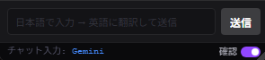

# Twitch Chat Translator

[日本語](README.md) | [English](README.en.md) | [Русский](README.ru.md)


📖 **詳しい使い方・FAQ・トラブルシューティングは [Wiki](https://github.com/KAWAchan-jp/twitch-chat-translate-ext/wiki) へ**（English overview available）

**Twitch の言葉の壁をなくす Chrome 拡張**

> *「サン・バベル」*（Sans Babel）— フランス語で「バベルなし」を意味します。
> 聖書の創世記によれば、バベルの塔が建てられたことにより神が人々の言語を混乱させ、言葉の壁が生まれたとされています。
> この拡張機能はその壁を取り除くために作られました。

| | |
|---|---|
| 💬 **チャットをリアルタイム翻訳** | 流れるチャットを即座に日本語へ。外国語配信もチャットごと楽しめる |
| ✏️ **日本語でチャットに参加** | 日本語で入力すると自動翻訳して送信。言語が違っても配信者と話せる |
| 🤖 **Gemini AI 翻訳** | 送信メッセージの翻訳に Gemini AI を使用。ゲーム用語・スラングにも強い自然な翻訳 |

---

## 機能

### チャット翻訳
- **リアルタイム翻訳** — チャットが流れるたびに自動翻訳（Google Translate / DeepL）・3並列処理
- **弾幕モード** — チャットの流速が速いとき（3msg/秒以上）は自動で翻訳を控えて原文表示。スクロールを止める・ホバーで見えている範囲だけ翻訳（API消費を節約）
- **翻訳エンジン表示** — ヘッダーに `JA→JA・Google` のように翻訳方向と使用エンジンを常時表示。チャンネル別設定があるときはオレンジ色
- **フッター翻訳エンジンインジケーター** — パネル最下部に自分のメッセージの翻訳エンジンをリアルタイム表示。クリックで有効化済みエンジンを巡回切替可能
- **配信言語の自動検出** — Twitch のタグから配信言語を取得して翻訳元言語に自動設定
- **フローティングパネル** — ページ右下に常駐。ヘッダーのドラッグで移動、右下のツマミでリサイズ、透過率調整も可能
- **チャンネル自動検出** — URL からチャンネルを自動取得。SPA ナビゲーションにも対応
- **チャンネル別言語設定** — チャンネルごとに翻訳元・翻訳先を記憶して自動切り替え
- **スクロール一時停止** — 上にスクロールすると自動スクロールが止まり「↓ 最新へ」ボタンが出現
- **翻訳キャッシュ** — 同一テキストはキャッシュから即返却（外部サービス利用時の使用文字数を節約）
- **翻訳して送信** — Twitch ログイン後、パネルの入力欄から翻訳済みメッセージを送信（DeepL・Gemini AI 利用可能）
- **最小文字数フィルター** — 短い煽り・スタンプ文字列をスキップ（文字数は調整可能）
- **同一言語フィルター** — 翻訳先と同じ言語のメッセージをスキップ

### Gemini AI 翻訳

- **モデル選択** — Gemini 2.5 Flash（推奨）/ 3.1 Flash Lite / 3 Flash / 3.5 Flash から選択可能
- **機能別選択** — 送信メッセージ翻訳の ON/OFF。チャット翻訳は Google / DeepL のまま（量が多いため Google 推奨）
- **プロンプト編集** — オプションページで翻訳プロンプトを自由にカスタマイズ可能。`{lang}` が翻訳先言語、`{text}` が翻訳対象のテキストに置き換わる
- **フォールバック** — Gemini が無効または失敗した場合、DeepL → Google Translate の順に自動フォールバック
- **無料枠** — 1,500リクエスト/日・15リクエスト/分（Google AI Studio で APIキー取得）

---

## 動作要件

- **Chrome** 最新版（Manifest V3 対応）

---

## インストール

1. このリポジトリを ZIP でダウンロード、または `git clone`
2. Chrome で `chrome://extensions/` を開く
3. 右上の **デベロッパーモード** を ON にする
4. **「パッケージ化されていない拡張機能を読み込む」** → `extension/` フォルダを選択
5. ツールバーのパズルアイコン（🧩）→ **Twitch Chat Translator** をピン留め

---

## 使い方

### パネルヘッダーの見方


| 表示 | 説明 |
|------|------|
| ● ステータスドット | チャット接続状態（緑＝接続中、黄点滅＝接続処理中、ピンク＝切断・停止） |
| **#チャンネル名** | 接続中のチャンネル。右側にプレイ中のゲーム名も表示 |
| **EN→JA・Google** | 翻訳方向と使用エンジン。**オレンジ色**のときはこのチャンネル専用の言語設定が保存されています |
| 数字（0.6.37 など） | 拡張機能のバージョン |
| **×** | パネルを閉じる（チャット受信・翻訳も停止） |

### パネルフッターの見方



パネル最下部のフッターに、現在使用中の翻訳エンジンをリアルタイムで表示します。

| 表示 | 説明 |
|------|------|
| **チャット入力:** | 自分が入力して送信するメッセージの翻訳エンジン（Google / <span style="color:#00c4a0">DeepL</span> / <span style="color:#4285f4">Gemini</span>）。</br><span style="color:#e84393">**⚠ 翻訳元言語が「自動検出」の場合は翻訳送信が無効になります**</span> |

オプションの設定変更はフッターにリアルタイム反映されます。**フッターの表示をクリックすると、有効化済みのエンジンを順番に切替できます**（Google→DeepL→Gemini。オプションで有効化していないエンジンは候補に出ません）。

| 操作 | 動作 |
|------|------|
| アイコンをクリック | パネルの表示 / 非表示を切り替え（初期状態は非表示） |
| アイコンを右クリック | 翻訳元・翻訳先言語の変更、表示設定 |
| パネルのヘッダーをドラッグ | パネルを移動 |
| パネル右下のツマミをドラッグ | パネルをリサイズ |
| パネルを上にスクロール | 自動スクロールを一時停止 |
| 「↓ 最新へ」ボタン | 最下部へ移動して自動スクロール再開 |

チャンネルごとに言語設定が保存されます。別チャンネルに移動すると自動で切り替わります。

### 翻訳エンジンの切り替え

フッターの各項目をクリックすると、オプションで有効にしたエンジンをその場で切り替えられます。設定ページを開かずに素早く変更可能です。

| フッター項目 | クリックで切り替わるエンジン |
|---|---|
| **チャット入力:** | Google → DeepL → Gemini（有効なものだけ） |

> エンジンを使えるようにするにはオプションページで API キーを設定して有効化する必要があります。有効化していないエンジンはスキップされます。

### チャット送信

1. アイコンを右クリック → 翻訳元言語を設定
2. パネルの **「Twitchでログイン」** をクリック
3. ログイン後、パネル下部の入力欄に日本語で入力して送信
4. 自動翻訳されてチャンネルに投稿されます

---

## オプション設定

拡張機能アイコンを右クリック → **「オプション」** から開きます。

| 設定項目 | 内容 |
|----------|------|
| **DeepL を有効にする** | Google Translate の代わりに DeepL を使用 |
| **DeepL 使用機能の選択** | チャット翻訳・送信メッセージを個別に ON/OFF |
| **DeepL API キー** | 無料版（末尾 `:fx`）・有料版どちらも対応 |
| **Gemini を有効にする** | Gemini AI を有効化。機能別トグルで送信メッセージ翻訳の ON/OFF を選択 |
| **Gemini モデル** | 2.5 Flash（推奨）/ 3.1 Flash Lite / 3 Flash / 3.5 Flash |
| **Gemini API キー** | Google AI Studio で取得。無料枠：1,500リクエスト/日・15リクエスト/分 |
| **Gemini プロンプト** | 翻訳指示を自由にカスタマイズ。`{lang}` = 翻訳先言語、`{text}` = 翻訳対象のテキスト |
| **デフォルト翻訳先言語** | チャンネル別設定がない場合の翻訳先言語 |
| **同一言語フィルター** | 翻訳先と同じ言語のメッセージをスキップ |
| **最小文字数フィルター** | 指定文字数未満のメッセージをスキップ |
| **パネル透過率** | パネルの背景透過率（30〜100%、デフォルト: 80%。ホバーで不透明） |

> DeepL 無料枠は 50万文字/月。Gemini 無料枠は 1,500リクエスト/日・15リクエスト/分。機能別トグルで必要な箇所だけ有効にすることで節約できます。

---

## ファイル構成

```
twitch-chat-translate-ext/
├── extension/              # Chrome が読み込む拡張本体
│   ├── manifest.json       # 拡張の設定（Manifest V3）
│   ├── background.js       # Service Worker（翻訳APIプロキシ、キャッシュ、OAuth）
│   ├── content.js          # コンテンツスクリプト メイン（定数・状態・初期化・設定）
│   ├── content-panel.js    # コンテンツスクリプト（Shadow DOM パネル・UI）
│   ├── content-chat.js     # コンテンツスクリプト（IRC・チャット翻訳・弾幕）
│   ├── auth-callback.js    # OAuth コールバック用コンテンツスクリプト
│   ├── help.html           # 使い方ページ（アイコン右クリック →「📖 使い方」）
│   ├── options.html / options.js / options.css
│   └── icons/
├── scripts/
│   └── build-release.ps1   # リリース ZIP 作成スクリプト
└── docs/images/            # ドキュメント用画像
```

---

## 技術的な詳細

### 翻訳

`translate.googleapis.com` への直接 fetch は CORS で弾かれるため、  
content.js → background.js（Service Worker）経由でリクエストしています。

翻訳エンジンの優先順位：**Gemini → DeepL → Google**（上位が有効なら下位は使われず、エラー時は自動フォールバック）。  
チャット翻訳は Google / DeepL のみ対応（量が多いため Gemini は非推奨）。送信メッセージは Gemini も選択可能。  
同一テキスト・言語ペアの結果はメモリ上のキャッシュ（LRU 方式）に保存され、再翻訳をスキップします。

### チャット受信・送信

Twitch IRC over WebSocket（`wss://irc-ws.chat.twitch.tv:443`）に直接接続します。

- 未ログイン時：`justinfan` の匿名ユーザーで読み取り専用接続
- ログイン時：OAuth トークンで認証し、`PRIVMSG` コマンドで送信

### OAuth

Twitch の Implicit Grant フローを使用します。

1. 拡張が `id.twitch.tv/oauth2/authorize` を新しいタブで開く
2. 認証後、`kawachan-jp.github.io/twitch-chat-translate/` にリダイレクト
3. そのページに注入した `auth-callback.js` が URL フラグメントからトークンを取得し background.js に転送

### パネル

Shadow DOM でページの CSS から分離しています（`attachShadow({ mode: 'open' })`）。

---

## 設定のデフォルト値

| 設定 | デフォルト |
|------|-----------|
| 翻訳元言語 | 自動検出 |
| 翻訳先言語 | 日本語 |
| 原文を表示 | ON |
| 自動スクロール | ON |
| DeepL を使用 | OFF |
| Gemini を使用 | OFF |
| Gemini モデル | 2.5 Flash |
| 同一言語フィルター | OFF |
| 最小文字数フィルター | OFF（4文字） |
| パネル透過率 | 80% |

---

## リリース ZIP の作成

配布用 ZIP は、リポジトリ全体を手動で圧縮せず、次のスクリプトで作成します。

```powershell
# 拡張本体（twitch-chat-translator-vX.Y.Z.zip）
powershell -NoProfile -ExecutionPolicy Bypass -File scripts\build-release.ps1
```

`extension/manifest.json` の version を使って `twitch-chat-translator-vX.Y.Z.zip` を生成します。ZIP 内では `manifest.json` がルートに配置されます。`.github/`、`.gitignore`、`CLAUDE.md` などの開発用ファイルは配布 ZIP に含めません。

---

## 機能要望・改善提案

Issue や Pull Request を歓迎します。  
「こんな機能があったら便利」という要望も気軽にどうぞ。

---

## ライセンス

[MIT License](LICENSE)
