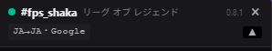
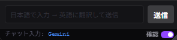

# Twitch Chat Translator

[日本語](README.md) | [English](README.en.md) | [Русский](README.ru.md)


📖 **Подробное руководство, FAQ и устранение неполадок доступны в [Wiki](https://github.com/KAWAchan-jp/twitch-chat-translate-ext/wiki)** (доступен обзор на английском)

**Chrome-расширение, которое убирает языковой барьер на Twitch**

> *«Sans Babel»* по-французски означает «без Вавилона».
> Согласно Книге Бытия, после строительства Вавилонской башни языки людей были смешаны, и так возник языковой барьер.
> Это расширение создано, чтобы убрать этот барьер.

| | |
|---|---|
| 💬 **Перевод чата в реальном времени** | Мгновенно переводит поток сообщений на японский, чтобы можно было наслаждаться зарубежными трансляциями вместе с чатом |
| ✏️ **Участие в чате на японском** | Пишите на японском, а расширение автоматически переведет и отправит сообщение, даже если стример говорит на другом языке |
| 🤖 **Перевод Gemini AI** | Использует Gemini AI для перевода отправляемых сообщений. Хорошо передает игровые термины, сленг и естественную речь |

---

## Возможности

### Перевод чата

- **Перевод в реальном времени** — автоматически переводит сообщения по мере их появления через Google Translate или DeepL, с тремя параллельными обработчиками.
- **Режим быстрого чата** — если чат движется слишком быстро (3 сообщения/сек или больше), перевод автоматически ограничивается и показывается исходный текст. Остановите прокрутку или наведите курсор, чтобы переводить только видимую область и экономить API.
- **Отображение движка перевода** — в заголовке всегда показываются направление перевода и движок, например `JA→JA・Google`. Оранжевый цвет означает, что включены настройки для конкретного канала.
- **Индикатор движка перевода в футере** — внизу панели в реальном времени показывается движок перевода ваших сообщений. Щелчок переключает между включёнными движками.
- **Автоопределение языка трансляции** — получает язык из тегов Twitch и автоматически задает исходный язык.
- **Плавающая панель** — находится в правом нижнем углу страницы. Перетаскивайте заголовок, чтобы переместить панель, правый нижний маркер, чтобы изменить размер, и настройте прозрачность.
- **Автоопределение канала** — получает канал из URL и поддерживает SPA-навигацию Twitch.
- **Языковые настройки по каналам** — запоминает исходный и целевой языки для каждого канала и переключает их автоматически.
- **Пауза прокрутки** — при прокрутке вверх автопрокрутка останавливается и появляется кнопка «↓ Latest».
- **Кэш перевода** — одинаковый текст возвращается из кэша, что экономит лимит символов DeepL.
- **Перевод и отправка** — после входа в Twitch можно отправлять переведенные сообщения из поля ввода панели.
- **Фильтр минимальной длины** — пропускает короткие подколы и строки, похожие на эмоты. Порог символов можно менять.
- **Фильтр одинакового языка** — пропускает сообщения, уже написанные на целевом языке.

### Перевод Gemini AI

- **Выбор модели** — можно выбрать Gemini 2.5 Flash (рекомендуется), 3.1 Flash Lite, 3 Flash или 3.5 Flash.
- **Выбор по функциям** — Gemini можно включать и выключать для отправляемых сообщений. Перевод чата остается на Google / DeepL, так как сообщений много и для них рекомендуется Google.
- **Редактирование промпта** — на странице настроек можно свободно настраивать промпт перевода. `{lang}` заменяется целевым языком, а `{text}` — переводимым текстом.
- **Fallback** — если Gemini отключен или произошла ошибка, расширение автоматически переключается по порядку: DeepL → Google Translate.
- **Бесплатный лимит** — 1 500 запросов/день и 15 запросов/минуту. API-ключ можно получить в Google AI Studio.

---

## Требования

- **Chrome** последней версии с поддержкой Manifest V3.

---

## Установка

1. Скачайте этот репозиторий ZIP-архивом или выполните `git clone`.
2. Откройте в Chrome `chrome://extensions/`.
3. Включите **Developer mode** в правом верхнем углу.
4. Нажмите **Load unpacked** и выберите папку `extension/`.
5. Нажмите значок пазла (🧩) на панели инструментов и закрепите **Twitch Chat Translator**.

---

## Использование

### Заголовок панели



| Отображение | Описание |
|-------------|----------|
| ● Индикатор статуса | Состояние подключения к чату: зеленый = подключено, желтый мигающий = подключение, розовый = отключено/остановлено |
| **#имя_канала** | Подключенный канал. Справа также показывается текущая игра |
| **EN→JA・Google** | Направление и движок перевода. **Оранжевый** цвет означает сохраненные языковые настройки для канала |
| Число вроде 0.6.37 | Версия расширения |
| **×** | Закрывает панель и останавливает получение/перевод чата |

### Футер панели



В нижней части панели в реальном времени показываются текущие движки перевода.

| Отображение | Описание |
|-------------|----------|
| **Chat input:** | Движок перевода для сообщений, которые вы вводите и отправляете (Google / <span style="color:#00c4a0">DeepL</span> / <span style="color:#4285f4">Gemini</span>) |

Изменения на странице настроек сразу отражаются в футере. **Щелчок по элементу футера переключает между включёнными движками** (Google→DeepL→Gemini — невключённые в настройках движки пропускаются).

| Действие | Поведение |
|----------|-----------|
| Щелчок по значку | Показать/скрыть панель (по умолчанию скрыта) |
| Правый щелчок по значку | Изменить исходный/целевой язык и настройки отображения |
| Перетаскивание заголовка панели | Переместить панель |
| Перетаскивание правого нижнего маркера | Изменить размер панели |
| Прокрутка панели вверх | Приостановить автопрокрутку |
| Кнопка «↓ Latest» | Перейти вниз и возобновить автопрокрутку |

Языковые настройки сохраняются для каждого канала. При переходе на другой канал они переключаются автоматически.

### Переключение движков перевода

Щелчок по любому элементу футера переключает включённые движки прямо из панели — открывать страницу настроек не нужно.

| Элемент футера | Движки при щелчке |
|---|---|
| **Chat input:** | Google → DeepL → Gemini (только включённые) |

> Чтобы движок появился в цикле, нужно задать API-ключ и включить его на странице настроек. Выключенные движки пропускаются.

### Отправка сообщений в чат

1. Щелкните правой кнопкой по значку и задайте исходный язык.
2. Нажмите **Log in with Twitch** на панели.
3. После входа введите сообщение на японском в нижнем поле панели и отправьте.
4. Сообщение будет автоматически переведено и опубликовано в канале.

---

## Настройки

Откройте настройки через правый щелчок по значку расширения → **Options**.

| Настройка | Описание |
|-----------|----------|
| **Включить DeepL** | Использовать DeepL вместо Google Translate |
| **Выбор функций DeepL** | Отдельное включение DeepL для перевода чата и отправляемых сообщений |
| **API-ключ DeepL** | Поддерживаются бесплатные ключи с окончанием `:fx` и платные ключи |
| **Включить Gemini** | Включает Gemini AI. Переключатель по функциям управляет переводом отправляемых сообщений |
| **Модель Gemini** | 2.5 Flash (рекомендуется) / 3.1 Flash Lite / 3 Flash / 3.5 Flash |
| **API-ключ Gemini** | Получается в Google AI Studio. Бесплатный лимит: 1 500 запросов/день и 15 запросов/минуту |
| **Промпт Gemini** | Настройка инструкций перевода. `{lang}` = целевой язык, `{text}` = переводимый текст |
| **Целевой язык по умолчанию** | Целевой язык, если для канала нет отдельной настройки |
| **Фильтр одинакового языка** | Пропускать сообщения, уже написанные на целевом языке |
| **Фильтр минимальной длины** | Пропускать сообщения короче указанного числа символов |
| **Прозрачность панели** | Прозрачность фона панели: 30-100%, по умолчанию 80%. При наведении панель становится непрозрачной |

> Бесплатный лимит DeepL составляет 500 000 символов в месяц. Бесплатный лимит Gemini — 1 500 запросов/день и 15 запросов/минуту. Включайте их только для нужных функций, чтобы экономить лимиты.

---

## Структура файлов

```text
twitch-chat-translate-ext/
├── extension/              # Пакет расширения, который загружает Chrome
│   ├── manifest.json       # Настройки расширения (Manifest V3)
│   ├── background.js       # Service Worker (прокси API перевода, кэш, OAuth)
│   ├── content.js          # Главный content script (константы, состояние, инициализация, настройки)
│   ├── content-panel.js    # Content script (панель Shadow DOM и UI)
│   ├── content-chat.js     # Content script (IRC, перевод чата, режим быстрого чата)
│   ├── auth-callback.js    # Content script для OAuth callback
│   ├── help.html           # Страница помощи (правый щелчок по значку → “📖 Help”)
│   ├── options.html / options.js / options.css
│   └── icons/
├── scripts/
│   └── build-release.ps1   # Скрипт создания release ZIP
└── docs/images/            # Изображения для документации
```

---

## Технические детали

### Перевод

Прямые запросы `fetch` к `translate.googleapis.com` блокируются CORS, поэтому запросы идут из `content.js` через `background.js` (Service Worker).

Приоритет движков перевода: **Gemini → DeepL → Google**. Если включен более приоритетный движок, используется он, а при ошибке расширение автоматически переключается на следующий.
Перевод чата поддерживает только Google / DeepL, так как сообщений много и Gemini для этого не рекомендуется. Отправляемые сообщения также могут использовать Gemini.
Результаты для одинаковых текстов и языковых пар сохраняются в LRU-кэше в памяти, чтобы не переводить их повторно.

### Получение и отправка чата

Расширение подключается напрямую к Twitch IRC через WebSocket: `wss://irc-ws.chat.twitch.tv:443`.

- Без входа: подключение только для чтения как анонимный пользователь `justinfan`.
- После входа: аутентификация OAuth-токеном и отправка сообщений командой `PRIVMSG`.

### OAuth

Используется Twitch Implicit Grant flow.

1. Расширение открывает `id.twitch.tv/oauth2/authorize` в новой вкладке.
2. После аутентификации Twitch перенаправляет на `kawachan-jp.github.io/twitch-chat-translate/`.
3. `auth-callback.js`, внедренный на эту страницу, считывает токен из URL-фрагмента и передает его в `background.js`.

### Панель

Панель использует Shadow DOM, чтобы изолироваться от CSS страницы: `attachShadow({ mode: 'open' })`.

---

## Настройки по умолчанию

| Настройка | Значение по умолчанию |
|-----------|-----------------------|
| Исходный язык | Auto detect |
| Целевой язык | Japanese |
| Показывать исходный текст | ON |
| Автопрокрутка | ON |
| Использовать DeepL | OFF |
| Использовать Gemini | OFF |
| Модель Gemini | 2.5 Flash |
| Фильтр одинакового языка | OFF |
| Фильтр минимальной длины | OFF (4 символа) |
| Прозрачность панели | 80% |

---

## Создание release ZIP

Для дистрибутивного ZIP используйте скрипт упаковки, а не ручное архивирование всего репозитория.

```powershell
# Расширение (twitch-chat-translator-vX.Y.Z.zip)
powershell -NoProfile -ExecutionPolicy Bypass -File scripts\build-release.ps1
```

Скрипт берет версию из `extension/manifest.json` и создает `twitch-chat-translator-vX.Y.Z.zip`. В ZIP файл `manifest.json` находится в корне архива. Файлы разработки, такие как `.github/`, `.gitignore` и `CLAUDE.md`, не включаются в release ZIP.

---

## Запросы функций и улучшения

Issues и pull requests приветствуются. Предлагайте функции, которые сделали бы расширение удобнее.

---

## Лицензия

[MIT License](LICENSE)
